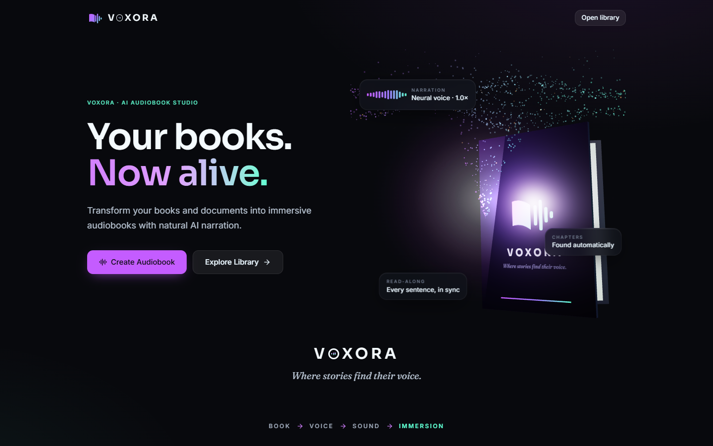
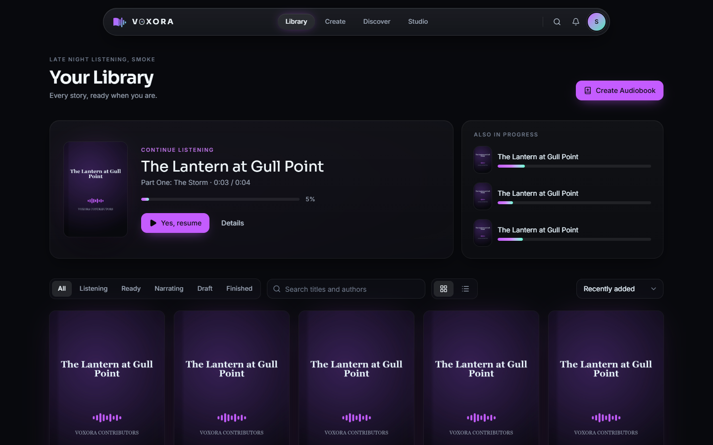
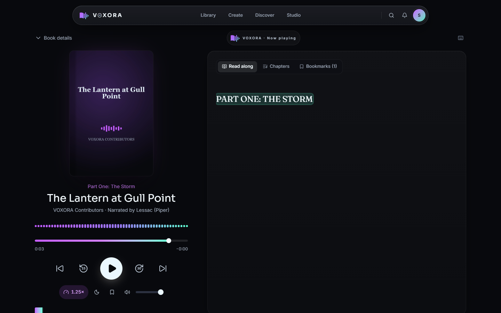
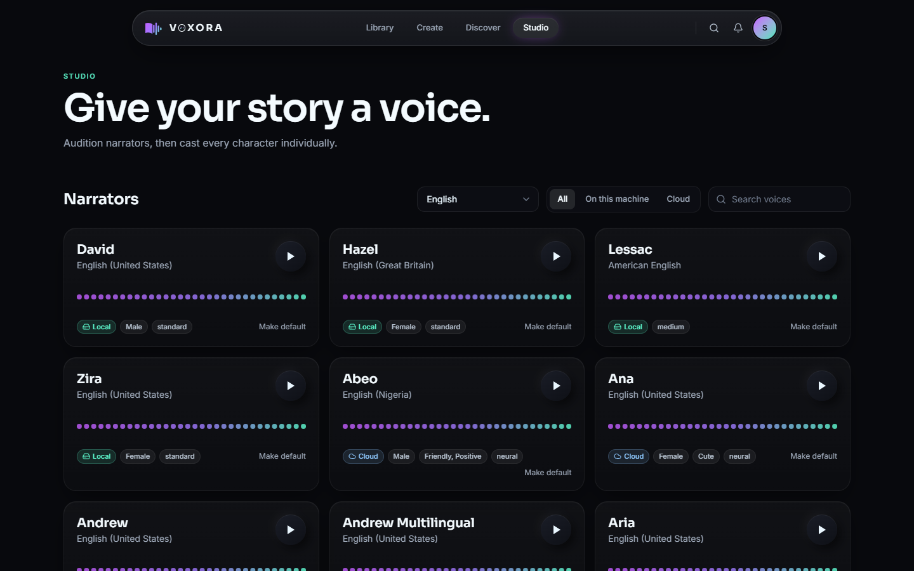
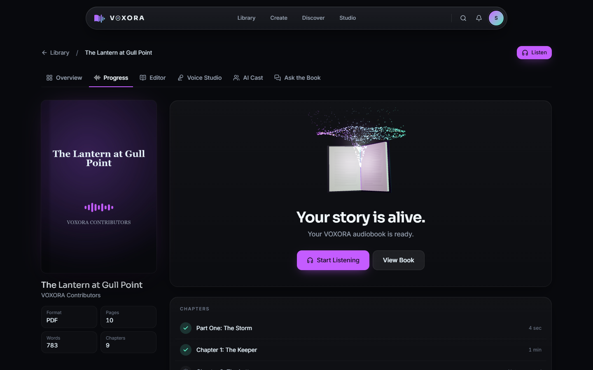

# VOXORA

### Where stories find their voice.

VOXORA is an AI-powered audiobook studio that transforms books and documents into immersive listening experiences. Drop in a PDF, EPUB, DOCX, TXT or scanned book; VOXORA reads it, finds the chapters, lets you review everything, gives it a natural voice, and hands you a chapter-by-chapter audiobook with a player that remembers exactly where you stopped.

It is **local-first**: by default everything (text extraction, OCR, neural narration, storage, search, and the AI model) runs on your own machine. Cloud voices and cloud AI are opt-in, and the app always tells you where your book is processed.



---

## Features

| | |
|---|---|
| **Any book** | PDF, EPUB, DOCX, TXT, Markdown, scanned PDFs and page photos (JPG/PNG/WebP/TIFF). Scans are detected per page and OCR'd automatically (RapidOCR, Tesseract or EasyOCR), with confidence warnings. |
| **Clean text** | Headers/footers, page numbers, hyphenation (`CHAP-/TER` → `CHAPTER`), broken line wraps and OCR artifacts are repaired without merging real paragraphs. |
| **Real structure** | Chapters, parts, prologue/epilogue, TOC, front and back matter from outlines, heading styles, numbering patterns and layout, never "every numbered paragraph". |
| **Book Studio** | Rename, reorder (drag or keyboard), merge, split, edit text, include/exclude, preview a chapter, see exactly what will be spoken. |
| **Narration Cleanup** | Optional: speaks abbreviations, times, numbers, dates, symbols and URLs naturally. Never paraphrases, summarizes or adds content. |
| **Voices** | Piper (local neural, installable voices), Windows SAPI, Microsoft Edge online voices (incl. Hindi, Telugu, Tamil, Kannada, Malayalam, Bengali, Marathi...), OpenAI-compatible TTS, ElevenLabs. Only languages a provider really supports are shown. |
| **Mixed-language books** | Language detected per paragraph; each language can have its own voice. |
| **AI Cast** *(experimental)* | Finds dialogue and speakers; give every character a voice. The text is never altered. |
| **Understands the book** | Classifies every section (title page, copyright, dedication, foreword, preface, introduction, contents, prologue, chapters, parts, epilogue, afterword, appendix, glossary, notes, author bio, ads) from headings, numbering, TOC, position and length. **Narrative Only** (default), **Full Book** or **Custom** decide what's narrated; nothing is deleted. Characters are detected automatically. |
| **Robust generation** | Background jobs, chapter-by-chapter, pause/resume/cancel, automatic retry with backoff, resume from the failed chapter, and a content-hash TTS cache so unchanged text is never synthesized twice. |
| **Audio** | Loudness normalization, silence trimming, optional compression, MP3 (default) / M4A / WAV, configurable bitrate, ID3 tags with cover and chapter markers, per-chapter files plus a full-book file. |
| **Player** | Resume exactly where you stopped (across devices), 0.75×–2× speed, sleep timer (minutes or end of chapter, with fade-out), bookmarks with notes, read-along sentence highlighting, keyboard shortcuts, lock-screen controls, audio-reactive visuals. |
| **Ask the Book** | Retrieval-augmented Q&A scoped to one book: hybrid dense + BM25 retrieval, cross-encoder reranking, citations, and a clear split between what the text says and the AI's inference. Optional spoiler-safe mode. |
| **Insights** | Optional summaries, chapter summaries, characters, key events, themes and glossary. |
| **Downloads** | Full audiobook (MP3), **M4B with chapter markers and cover**, individual chapters, extracted text, processed text, narration script, and a ZIP package with metadata and cover. |
| **Privacy** | Accounts with private libraries, signed expiring media URLs, delete the book, its audio or its original file at any time, no telemetry. |

<p>




</p>

---

## Quick start

### Prerequisites

- **Python 3.11+** (tested on 3.13)
- **Node.js 20+** (tested on 24)
- Optional: **Ollama** for a local AI model (Ask the Book, summaries), **Tesseract** for an extra OCR engine.

No database server, Redis, or ffmpeg install is required: SQLite, a database-backed job queue and a bundled ffmpeg are used by default.

### 1. Backend

```bash
cd backend
python -m venv .venv
# Windows
.venv\Scripts\pip install -r requirements.txt
# macOS / Linux
.venv/bin/pip install -r requirements.txt

cp .env.example .env        # optional: every setting has a local default
python main.py              # API + background worker on http://127.0.0.1:8000
```

The first run creates `backend/data/` (database, storage, models). The default Piper voice (`en_US-lessac-medium`) can be installed from **Voice Studio** with one click, or placed in `backend/data/voices/piper/`.

### 2. Frontend

```bash
cd frontend
npm install
npm run dev                 # http://localhost:5173 (proxies /api, /media, /ws to the backend)
```

Open http://localhost:5173, create an account (the first account becomes the admin), and bring in a book.

### Single-process mode

`npm run build` in `frontend/` produces `frontend/dist`, which the backend serves automatically: `python backend/main.py` then serves everything on port 8000.

From the repository root you can also use:

```bash
npm run setup      # installs backend (venv) + frontend dependencies
npm run backend    # python backend/main.py
npm run dev        # frontend dev server
npm test           # backend pytest + frontend vitest
```

---

## Generating an audiobook

1. **Create** → drop a file → **Add to VOXORA**. Watch the pages lift into the book while it's read; scans are OCR'd automatically.
2. **Review chapters** in Book Studio: fix titles, merge/split, exclude front matter.
3. **Choose a voice** in Voice Studio: audition narrators on a passage from your own book, tune speed and pauses.
4. **Create Audiobook.** Chapters generate in the background; you can pause, resume, cancel or retry a single chapter.
5. **Start Listening.** Close the app any time; VOXORA resumes exactly where you stopped.

---

## Performance

Measured on a 12-core CPU without a GPU (`scripts/benchmark_tts.py`, `scripts/benchmark_pipeline.py`):

| Stage | Measured |
|---|---|
| Reading & structuring (extract, clean, chapters) | ~270 pages/minute, <20 MB peak memory at 600 pages |
| Local Piper voice, old engine (one chunk at a time) | ~2.7x realtime |
| Local Piper voice, parallel engine (6 sessions x 2 threads, auto-sized) | 6-11x realtime (a real 15-min chapter in 83 s) |
| Edge cloud voices, 6 parallel requests | ~29x realtime (a 400-page novel in about 28 minutes) |

Chunks are synthesized in parallel but assembled strictly in sequence; each chapter encodes while the next one synthesizes; every chunk is cached by a hash of text + voice + settings, so a crash or edit only re-synthesizes what changed. Chapters are playable the moment they finish. A 400-page book takes about 1.5-2 hours with a local voice on a CPU like this, or about 30 minutes with cloud voices; a CUDA GPU is used automatically when onnxruntime-gpu is installed. Tune with `TTS_CONCURRENCY` and `PIPER_SESSIONS`.

## Configuration

All configuration is via environment variables (or `backend/.env`). See [`backend/.env.example`](backend/.env.example) for every option. The most important:

| Variable | Default | Meaning |
|---|---|---|
| `DATABASE_URL` | SQLite in `backend/data` | Any SQLAlchemy URL, e.g. `postgresql+psycopg://…` |
| `STORAGE_PROVIDER` | `local` | `local` or `s3` (any S3-compatible store; presigned download URLs) |
| `TTS_PROVIDER` | `piper` | `piper`, `sapi`, `edge`, `openai`, `elevenlabs` |
| `TTS_API_KEY`, `OPENAI_TTS_API_KEY`, `ELEVENLABS_API_KEY` | – | Cloud voices |
| `OCR_PROVIDER` | `auto` | `auto`, `rapidocr`, `tesseract`, `easyocr` |
| `LLM_PROVIDER` | `auto` | `auto` uses Claude when Anthropic credentials exist (`ANTHROPIC_API_KEY`), else the best installed local Ollama model; or `ollama`, `openai`, `anthropic`, `none` |
| `EMBEDDING_PROVIDER` | `fastembed` | Local embeddings: `bge-base-en-v1.5` for English, a multilingual model otherwise |
| `RERANK_ENABLED` | `true` | Cross-encoder reranking for Ask the Book |
| `MAX_FILE_SIZE_MB` | `300` | Upload limit |
| `RUN_WORKER_IN_PROCESS` | `true` | Set `false` and run `python -m app.workers.runner` to scale workers separately |

### OCR setup
RapidOCR installs with pip and works out of the box. For Tesseract, install it ([Windows builds](https://github.com/UB-Mannheim/tesseract/wiki), `brew install tesseract`, `apt install tesseract-ocr`) plus language packs (e.g. `tesseract-ocr-hin tesseract-ocr-tel`), and set `TESSERACT_CMD` if it isn't on `PATH`.

### TTS setup
- **Piper (default, local):** install voices from Voice Studio (downloads from the Piper voice catalog) or copy `.onnx` + `.onnx.json` files into `backend/data/voices/piper/`.
- **Edge voices (cloud, free):** enabled by default; text is sent to Microsoft's speech service, and VOXORA asks before sending a book.
- **OpenAI / ElevenLabs:** set the API key; cost estimates are shown when pricing is known.

### AI model setup
- **Local:** install [Ollama](https://ollama.com) and pull a chat model (`ollama pull qwen3` or `llama3.1:8b`). VOXORA picks the best one installed.
- **Claude:** set `ANTHROPIC_API_KEY` (or `LLM_PROVIDER=anthropic` + `LLM_API_KEY`). Relevant passages are sent to Anthropic; the UI labels this.

### Database & Redis
SQLite is the default and needs no setup. For PostgreSQL, install `psycopg[binary]` and set `DATABASE_URL`. Redis is **not** required: jobs are durable rows in the database (see [ARCHITECTURE.md](ARCHITECTURE.md#background-jobs)), which survive restarts and work on Windows.

---

## Development

```bash
# backend tests (hermetic: fake TTS engine, temp database; real OCR/ffmpeg/pipeline)
cd backend && .venv/Scripts/python -m pytest -q

# end-to-end smoke test against a running server
.venv/Scripts/python scripts/e2e_smoke.py tests/fixtures/lantern-at-gull-point.pdf

# frontend
cd frontend && npm run typecheck && npm test && npm run build
```

The sample book *The Lantern at Gull Point* is an original public-domain (CC0) text used for tests and demos; `backend/scripts/make_sample_books.py` regenerates it as TXT, PDF, scanned PDF, DOCX and EPUB.

### Project layout

```
backend/
  app/
    api/routes/          REST + WebSocket endpoints
    core/                config, security, errors, logging, rate limiting
    db/ models/ schemas/ SQLAlchemy models and API serializers
    document_processing/ PDF/DOCX/EPUB/TXT/image extraction, cleaning, structure, language
    providers/           tts/ ocr/ llm/ embeddings/ storage/ rerank (swappable)
    services/            ingest, generation, RAG, cast, insights, export
    audio/               ffmpeg, processing, tags, covers
    workers/             durable job queue + worker pool
  tests/                 pytest suite + sample-book fixtures
frontend/
  src/
    components/          brand/ 3d/ audio/ navigation/ player/ book/ ui/ layout/
    features/            editor/ player/ voice/ ask/ book/ auth/
    pages/               one file per screen
    services/ stores/ hooks/ config/ types/ utils/
```

---

## Troubleshooting

| Symptom | Fix |
|---|---|
| "Can't reach the VOXORA server" | Start the backend (`python backend/main.py`); the dev server proxies to `127.0.0.1:8000` (`VITE_API_PROXY` to change). |
| No voices listed | Install a Piper voice in Voice Studio, or enable Edge voices (`TTS_ENABLED_PROVIDERS`). |
| Scanned PDF produced no text | Check **Settings → Privacy** shows an OCR engine; try "Read every page as a scan" in Create → Reading options. |
| Ask the Book answers slowly | Local models on CPU can take a minute; set `ANTHROPIC_API_KEY` for Claude, or pull a smaller Ollama model. Answers still return the best passages if no model is available. |
| First question is slow once | The embedding and reranking models download on first use (~0.4 GB); the server warms them up in the background at start. |
| Port already in use | `PORT=8010 python main.py` and `VITE_API_PROXY=http://127.0.0.1:8010 npm run dev`. |

---

## Roadmap

Articles & web pages · research papers & lecture notes · translation · narration styles & ambient soundscapes · shared libraries and collections · cloud sync · mobile and desktop apps. The provider and job architecture is built so these can be added without rewrites.

## Responsible use

VOXORA is for books you own, have permission to use, or that are in the public domain. It does not remove DRM and does not download books from anywhere.
