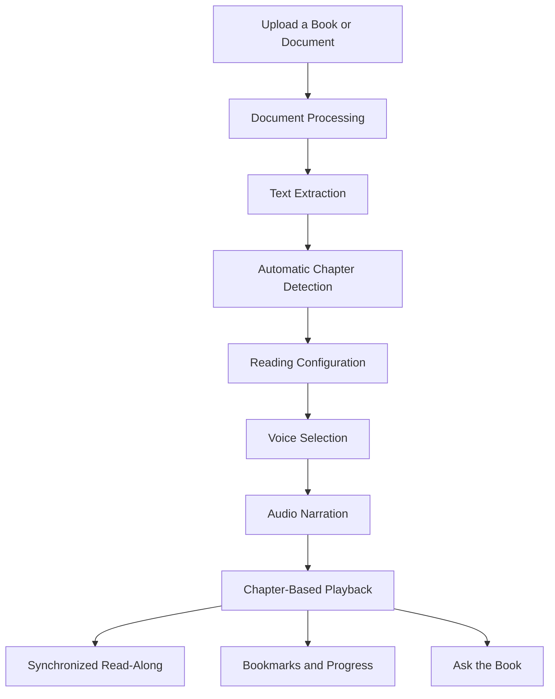
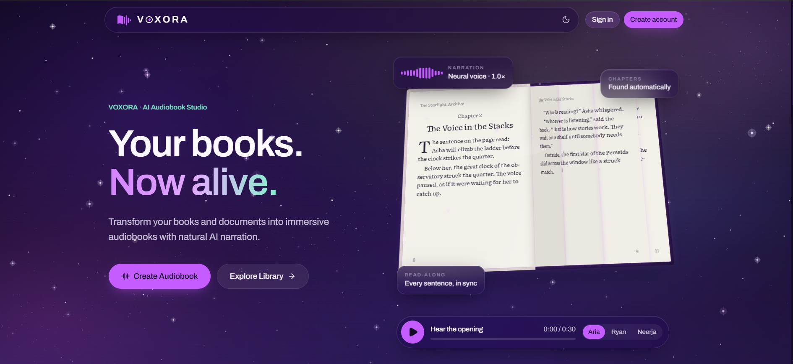
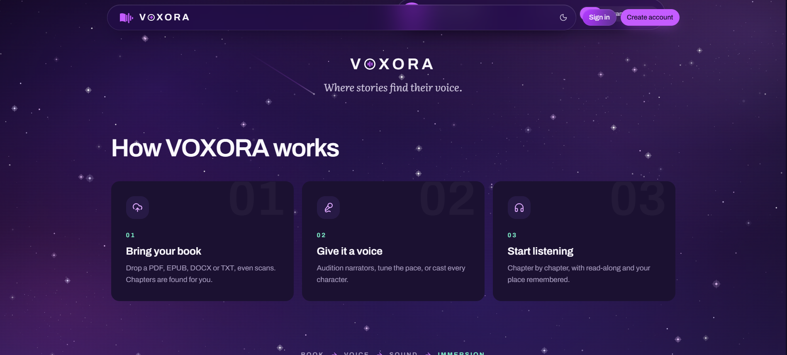
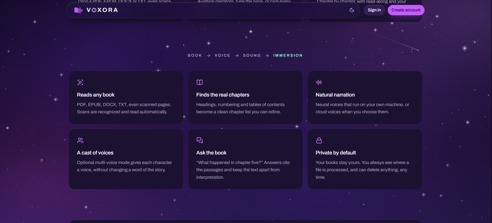
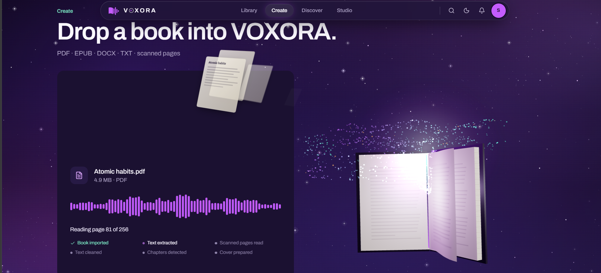
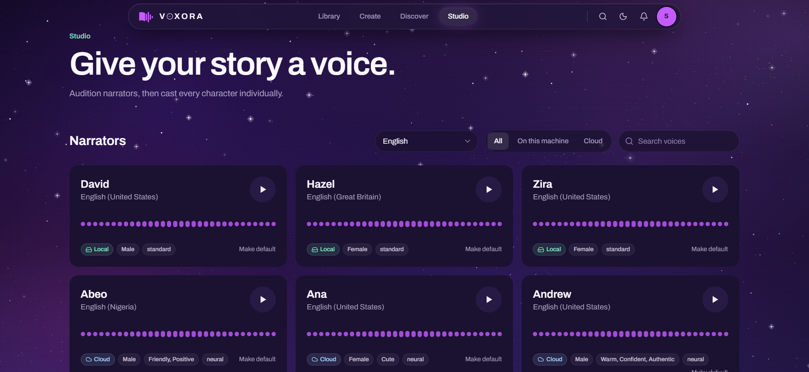
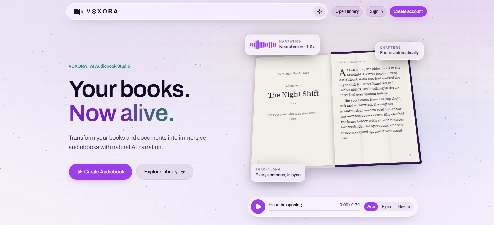
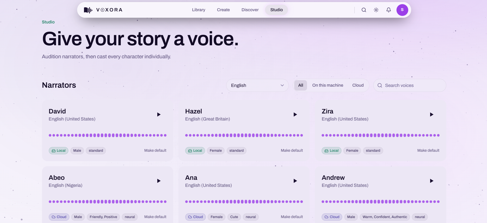
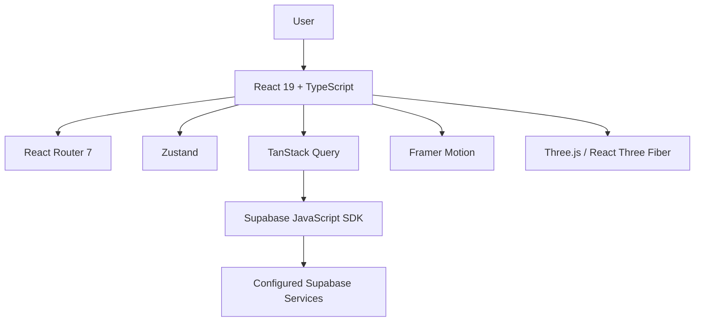

# VOXORA — Where Stories Find Their Voice. 🎧

<div align="center">

### Your Books. Your Voices. Your Listening Experience.

**An AI-powered Audiobook Studio that transforms books and documents into immersive, personalized listening experiences.**

### 🌐 [Try VOXORA live → voxora-three-murex.vercel.app](https://voxora-three-murex.vercel.app)

<sub>Hosted on Vercel (frontend) and Render (backend). The free backend sleeps when idle, so the first load can take 30–60 seconds.</sub>

[Live Demo](https://voxora-three-murex.vercel.app) · [Features](#-key-features) · [Architecture](#️-system-architecture) · [Screenshots](#-product-showcase) · [Installation](#-getting-started)

</div>

<p align="center">
  
  
  
  
  
</p>

---

## 🌌 Overview

**VOXORA** is an AI-powered audiobook creation and reading platform designed to change how people experience written content.

Books are meant to be experienced, not just read. VOXORA transforms traditional documents into personalized listening experiences through intelligent document processing, automatic chapter discovery, natural voice narration, and interactive reading features.

Users can bring their own books, explore a collection of narrators, configure narration preferences, and enjoy their content chapter by chapter.

But VOXORA goes beyond conventional text-to-speech.

With features such as multi-character voice casting, synchronized read-along, personalized listening controls, and an interactive Ask the Book experience, it brings multiple dimensions of digital reading together in one platform.

**From a document to a voice. From a voice to an experience.**

That's VOXORA.

## ✨ Key Features

### 📚 1. Intelligent Document Processing

Bring your books and documents into VOXORA.

- Import PDF, EPUB, DOCX, and TXT documents.
- Support scanned-document reading workflows.
- Extract and prepare document content for narration.
- Organize uploaded books in a personal library.
- Configure reading options before audiobook creation.

### 🧠 2. Automatic Chapter Detection

Turn long documents into structured listening experiences.

- Identify chapter headings and numbering.
- Recognize document structure and tables of contents.
- Organize content into navigable chapters.
- Allow users to refine detected chapter structures.

### 🎙️ 3. AI-Powered Voice Studio

Discover the right voice for every listening experience.

- Browse available narrators.
- Explore local and cloud-based voice options.
- Filter narrators by language.
- Search for voices.
- Preview narration samples.
- Explore different accents and voice styles.
- Select a default narrator.
- Customize narration speed.

### 🎭 4. Multi-Character Voice Casting

Give every character a distinct voice.

- Assign different narrators to individual characters.
- Create more expressive storytelling experiences.
- Configure character-specific voice preferences.
- Preserve the original story while changing its narration experience.

### 📖 5. Synchronized Read-Along

Experience reading and listening together.

- Follow the text while narration plays.
- Synchronize displayed sentences with audio playback.
- Navigate through chapters.
- Continue from previously saved reading positions.

### 💬 6. Ask the Book

Make your books interactive with an AI-powered question experience.

- Ask questions about book content.
- Explore relevant passages.
- Receive answers with supporting citations.
- Distinguish source material from AI-generated interpretation.

### 🔖 7. Personalized Listening Experience

Build a listening experience around your preferences.

- Playback speed controls from 0.75× to 2×.
- Bookmarks and notes.
- Sleep timer.
- Listening progress tracking.
- Resume listening.
- Personal audiobook library.

### 🌍 8. Multilingual Voice Discovery

Explore narration options across Indian and international languages.

- Language-based voice discovery.
- Local and cloud voice categories.
- Voice search and filtering.
- Different accents and narration styles.

### 🔐 9. Privacy-Focused Reading

VOXORA emphasizes control and transparency when working with personal documents.

- Visibility into document-processing workflows.
- Content management and deletion controls.
- Local and cloud voice choices, depending on provider availability.

Actual processing and storage behavior depends on the configured deployment and service providers.

---

## 🧭 How VOXORA Works

VOXORA brings the complete audiobook creation workflow into one experience.



### The Four-Step Journey

**01 — BRING YOUR BOOK**

Upload a PDF, EPUB, DOCX, TXT, or scanned document.

**02 — DISCOVER ITS STRUCTURE**

Extract document content and organize it into chapters.

**03 — GIVE IT A VOICE**

Explore narrators, preview available voices, and configure narration preferences.

**04 — START LISTENING**

Enjoy chapter-based playback, synchronized reading, and personalized listening controls.

---


## 🖥️ Product Showcase

Explore the VOXORA interface, designed to deliver an immersive AI-powered audiobook experience.

### 01 — Welcome to VOXORA
*Where stories find their voice.*



### 02 — How VOXORA Works
*Bring your book, give it a voice, start listening.*



### 03 — Powerful Platform Features
*Reads any book, finds the real chapters, natural narration, a cast of voices, and Ask the Book.*



### 04 — Create Your Audiobook
*Drop in a PDF, EPUB, DOCX, TXT or scanned pages and watch it come to life.*



### 05 — AI Voice Studio
*Discover and audition local and cloud narrators.*



### 06 — Light Mode
*The same experience, in a bright daytime theme.*





---

## 🛠️ Technology Stack

VOXORA uses a modern frontend ecosystem built around React and TypeScript, supported by libraries for application state, data management, animations, 3D rendering, and testing.

### Frontend Development

| Technology | Purpose |
|---|---|
| React 19 | Component-based UI development |
| TypeScript | Type-safe application development |
| Vite 8 | Development server and production build tooling |
| React Router 7 | Application navigation |
| Tailwind CSS 4 | Utility-first styling |
| Framer Motion | Animations and transitions |
| Lucide React | Interface icons |

### State Management and Data

| Technology | Purpose |
|---|---|
| Zustand | Client-side state management |
| TanStack Query | Server-state management and asynchronous data fetching |
| Supabase JavaScript SDK | Supabase application integration |

### 3D Graphics and Visual Experience

| Technology | Purpose |
|---|---|
| Three.js | 3D rendering |
| React Three Fiber | React integration for Three.js |
| React Three Drei | Helpers and abstractions for 3D scenes |

### Testing and Development Tools

| Technology | Purpose |
|---|---|
| Vitest | Unit testing |
| React Testing Library | Component testing |
| Testing Library Jest DOM | DOM assertions |
| Testing Library User Event | User interaction testing |
| jsdom | Browser-like testing environment |
| TypeScript Compiler | Static type checking |

### Development Configuration

- Vite React plugin
- Tailwind CSS Vite integration
- npm package management

---

## 🏗️ System Architecture

VOXORA's verified frontend architecture is organized around reusable React components, dedicated state management, asynchronous data handling, and external service integration.



### Architectural Responsibilities

- **Presentation Layer:** React components and responsive user interfaces.
- **Navigation Layer:** React Router for application navigation.
- **Client State:** Zustand for shared application state.
- **Server State:** TanStack Query for asynchronous data management.
- **Integration Layer:** Supabase JavaScript SDK.
- **Visual Layer:** Framer Motion, Three.js, React Three Fiber, and Drei.
- **Testing Layer:** Vitest and React Testing Library.

The frontend dependencies establish the technologies above. Backend processing, database schema, audio-generation providers, and AI model architecture should be documented against their respective implementation files.

---

## 📂 Project Structure

The following is a conceptual structure for organizing the frontend. Adjust it to match the actual repository folders.

```text
VOXORA/
│
├── public/
│   └── assets/
│
├── screenshots/
│   ├── 01-landing-hero.png
│   ├── 02-how-voxora-works.png
│   ├── 03-platform-features.png
│   ├── 04-listening-experience.png
│   ├── 05-create-audiobook.png
│   ├── 06-voice-studio.png
│   └── 07-voice-catalog.png
│
├── src/
│   ├── components/
│   ├── pages/
│   ├── hooks/
│   ├── store/
│   ├── services/
│   ├── lib/
│   ├── assets/
│   ├── styles/
│   └── main.tsx
│
├── package.json
├── package-lock.json
├── tsconfig.json
├── vite.config.ts
└── README.md
```

---

## 🚀 Getting Started

Follow these steps to run the frontend locally.

### Prerequisites

Make sure you have:

- Node.js
- npm
- Git

### 1. Clone the Repository

```bash
git clone https://github.com/saisharatkaruturi/Voxora--Audiobook-Studio.git
```

### 2. Navigate to the Project

```bash
cd Voxora--Audiobook-Studio
```

### 3. Install Dependencies

```bash
npm install
```

### 4. Configure Environment Variables

Create a `.env` file using the configuration expected by the application.

Configure the required Supabase connection details and any other integrations used by your local setup.

Never commit actual credentials, API keys, or private configuration files.

### 5. Start the Development Server

```bash
npm run dev
```

Vite will display the local development URL in your terminal.

### 6. Build for Production

```bash
npm run build
```

### 7. Preview the Production Build

```bash
npm run preview
```

---

## 🧪 Testing and Code Quality

VOXORA's frontend configuration includes tools for automated testing and TypeScript validation.

Run the test suite:

```bash
npm test
```

Run tests in watch mode:

```bash
npm run test:watch
```

Run TypeScript checks:

```bash
npm run typecheck
```

Build the application:

```bash
npm run build
```

---

## 🔐 Security and Configuration

When working with VOXORA:

- Keep environment variables outside version control.
- Never expose private API keys in frontend source code.
- Use appropriate permissions for connected services.
- Validate uploaded documents and supported file types.
- Review the storage and retention configuration.
- Avoid committing personal documents or generated audio.
- Review cloud voice provider terms before processing sensitive content.

A production deployment should also include appropriate authentication, authorization, monitoring, backup, and infrastructure security reviews.

---

## 🗺️ Future Roadmap

Potential areas for continued development include:

- Expanded multilingual narration.
- More expressive character-based voice casting.
- Improved document and chapter recognition.
- Enhanced audiobook library organization.
- More reading accessibility features.
- Additional narration-provider integrations.
- Improved cross-device listening continuity.
- Enhanced AI-powered book interaction.

---

## 🤝 Contributing

Suggestions, feedback, and contributions are welcome.

1. Fork the repository.
2. Create a feature branch.
3. Implement your changes.
4. Test the relevant application workflows.
5. Submit a pull request with a clear description.

---

## 📄 License

No license has been specified in this repository. Add an appropriate LICENSE file before granting others permission to reuse, modify, or redistribute the project.

---

<div align="center">

# VOXORA

### Where Stories Find Their Voice.

**BOOKS → VOICE → SOUND → IMMERSION**

Built by **Sai Sharat Karuturi**

[GitHub Repository](https://github.com/saisharatkaruturi/Voxora--Audiobook-Studio)

</div>
